> 이 문서는 원본 [README.md](README.md)를 **어려운 말 없이 다시 풀어 쓴 쉬운 설명판**이에요. 같은 내용의 PDF는 [README_쉬운설명판.pdf](README_쉬운설명판.pdf)에 있어요.

# 내 컴퓨터에 개발자 '작업실' 만들기

**미션 1 · 초등학생도 이해하는 쉬운 설명판**

터미널 · Docker · Git/GitHub를 직접 해 보고, 모든 순간을 사진(증거)으로 남겼어요.

| 항목 | 내용 |
|---|---|
| 제출 저장소 | https://github.com/80gina/E1-1 |
| 브랜치 | main |
| 사용한 컴퓨터 | Windows 11 · PowerShell · Docker Desktop(WSL2) |
| Docker / Git 버전 | Docker 29.9.2 / Git 2.53.0 |
| 증거 사진 | 모두 57장 (이 문서에 전부 실려 있어요) |

> 이 문서는 <b>README.md(원본 기록)</b>를 어려운 말 없이 다시 풀어 쓴 <b>쉬운 설명판</b>이에요. 원본 README는 저장소에서 그대로 볼 수 있어요.


---

## 0. 이 문서 읽는 법

이 문서는 <b>'무엇을 했는지'</b>와 <b>'정말 했다는 증거(사진)'</b>를 짝지어 보여 줘요. 각 장은 이렇게 생겼어요.

- <b>쉬운 설명</b> : 어떤 일을 했고, 왜 했는지 비유로 말해 줘요.
- <b>명령어</b> : 컴퓨터에게 실제로 입력한 글자예요. (회색 상자)
- <b>그림</b> : 그때 찍은 화면이에요. 그림 이름의 번호(예: 21_docker_build)가 증거 번호예요.

> <b>그림 번호 약속</b> : 번호는 <b>한 일의 순서</b>예요. 01번이 맨 처음, 57번이 거의 마지막이에요. 맨 뒤 <b>부록</b>에 57장의 목록이 있어요.


### 차례

- 1. 한눈에 보기 : 세 가지 도구 이야기
- 2. 터미널 : 글자로 시키는 리모컨
- 3. 권한 : 서랍 열쇠 규칙
- 4. Docker 준비 : 도시락 가게 문 열기
- 5. 첫 도시락 : hello-world와 ubuntu
- 6. 내 레시피 : Dockerfile과 이미지
- 7. 정문 번호 : 포트 매핑
- 8. 창문과 사물함 : 바인드 마운트, 볼륨
- 9. 일기장과 클라우드 : Git과 GitHub
- 10. 보너스 1~4 : Docker Compose와 환경 변수
- 11. 보너스 5 : SSH 열쇠와 자물쇠
- 12. 포트가 겹치면? 직접 일으켜 본 실험
- 13. 어려웠던 일과 해결 방법
- 14. 질문과 쉬운 대답
- 15. 평가 문항 찾아보기
- 부록. 증거 사진 57장 목록


---

## 1. 한눈에 보기 : 세 가지 도구 이야기

컴퓨터로 프로그램을 만들 때 가장 먼저 필요한 건 <b>'작업실'</b>이에요. 작업실에는 도구 세 가지가 있어요.

| 도구 | 쉬운 말 | 비유 |
|---|---|---|
| <b>터미널</b> | 글자를 입력해서 컴퓨터에게 심부름을 시키는 창 | 말로 시키는 <b>리모컨</b> |
| <b>Docker</b> | 프로그램을 도시락처럼 포장해서 어느 컴퓨터에서나 똑같이 실행해 줘요 | <b>도시락 가게</b> |
| <b>Git</b> | 내 컴퓨터에서 무엇을 바꿨는지 기록해 줘요 | 책상 위 <b>일기장</b> |
| <b>GitHub</b> | 그 일기장을 인터넷에 올려 두는 곳이에요 | <b>클라우드 사물함</b> |


### 왜 이런 걸 만들까요?

"내 컴퓨터에서는 되는데, 친구 컴퓨터에서는 왜 안 되지?" 이런 일을 없애려고요. Docker로 포장하면 누구의 컴퓨터에서나 <b>똑같이</b> 움직여요.


### 내가 해낸 일

| 번호 | 해야 하는 일 | 결과 | 자세히 보기 |
|---|---|---|---|
| 1 | 터미널 기본 조작 | 완료 | 2장 |
| 2 | 파일 권한 바꾸기 | 완료 | 3장 |
| 3 | Docker 설치와 점검 | 완료 | 4장 |
| 4 | hello-world, ubuntu 실행 | 완료 | 5장 |
| 5 | 내 이미지 만들기(Dockerfile) | 완료 | 6장 |
| 6 | 포트 매핑으로 접속 | 완료 | 7장 |
| 7 | 바인드 마운트와 볼륨 | 완료 | 8장 |
| 8 | Git 설정과 GitHub 연결 | 완료 | 9장 |
| 보너스 | Compose, 환경 변수, SSH 키 | 5개 모두 완료 | 10~11장 |
| 어려웠던 일 | 오류를 만나 해결하기 | 6가지 + 직접 일으킨 실험 1가지 | 12~13장 |


---

## 2. 터미널 : 글자로 시키는 리모컨

터미널은 마우스 대신 <b>글자</b>로 컴퓨터에게 일을 시켜요. 폴더(서랍)를 만들고, 파일(종이)을 만들고, 옮기고, 지웠어요.

| 내가 입력한 말 | 컴퓨터가 한 일 | 비유 |
|---|---|---|
| <b>pwd</b> | 지금 있는 곳을 알려 줘요 | "나 지금 어디야?" |
| <b>ls -Force</b> | 안에 든 것을 모두 보여 줘요 (숨은 것까지) | 서랍 속 구경하기 |
| <b>mkdir practice</b> | 폴더를 만들어요 | 서랍 하나 새로 만들기 |
| <b>New-Item a.txt</b> | 빈 파일을 만들어요 | 빈 종이 한 장 |
| <b>cp / mv / rm</b> | 복사 / 이동·이름 바꾸기 / 지우기 | 복사기 / 옮기기 / 휴지통 |

```text
pwd                      # 지금 어디?
ls -Force                # 안에 뭐가 있나?
mkdir practice           # 폴더 만들기
New-Item a.txt           # 빈 파일 만들기
cp b.txt c.txt           # 복사
mv c.txt d.txt           # 이름 바꾸기
rm a.txt                 # 지우기
```

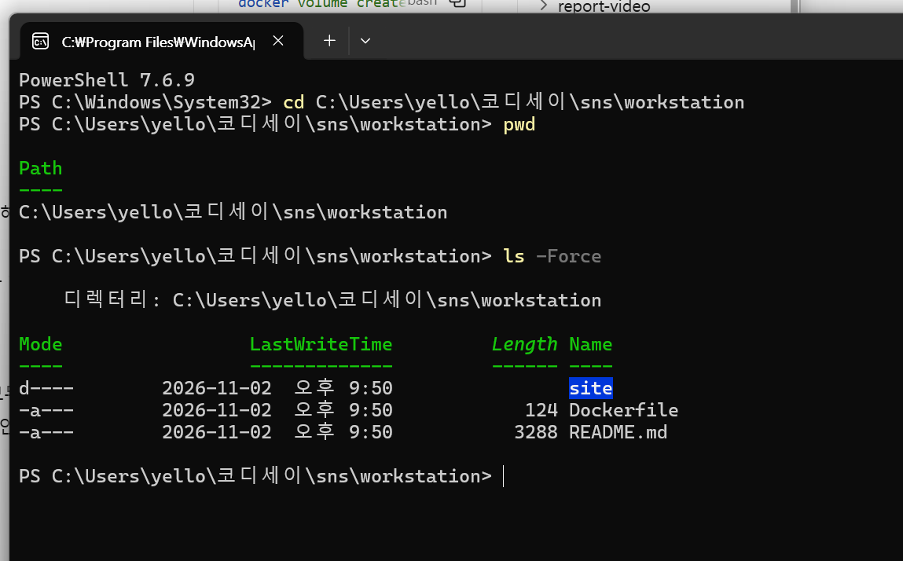

<sub>그림 01_pwd_ls : <b>지금 위치(pwd)와 안에 든 것(ls -Force)</b>을 확인했어요. workstation 폴더에 Dockerfile, README, site가 보여요.</sub>

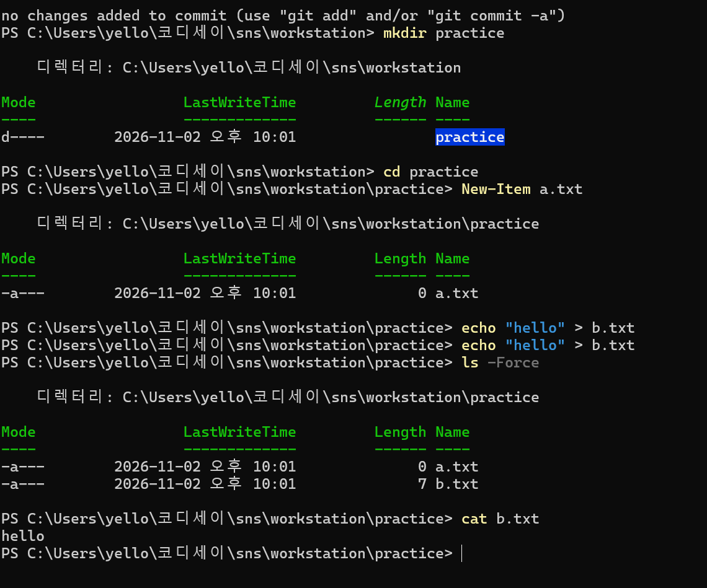

<sub>그림 03_create_files : <b>빈 파일(a.txt)과 글이 든 파일(b.txt)</b>을 만들었어요. cat으로 열어 보니 hello가 나와요.</sub>

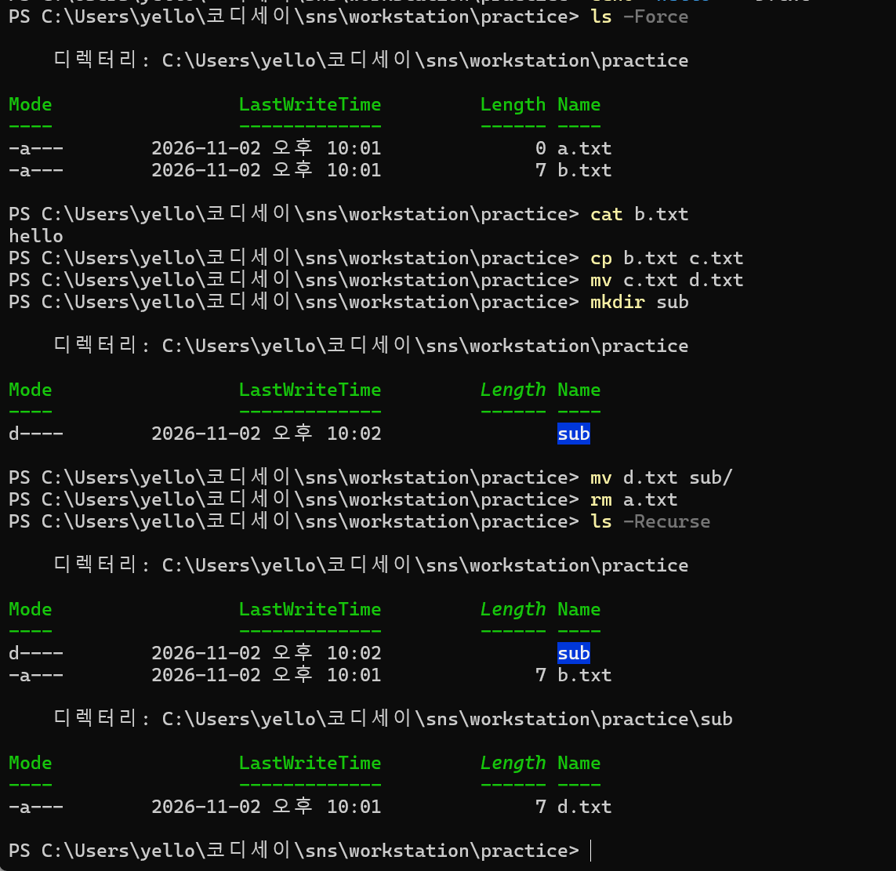

<sub>그림 04_copy_move_delete : <b>복사, 이름 바꾸기, 폴더로 옮기기, 지우기</b>를 했어요. 마지막 목록에 b.txt와 sub\d.txt만 남았어요.</sub>


---

## 3. 권한 : 서랍 열쇠 규칙

파일과 폴더에는 <b>"누가 무엇을 할 수 있는지"</b> 규칙이 있어요. 그 규칙을 바꿔 보고, 바뀌기 <b>전과 후</b>를 비교했어요.

| 글자 | 뜻 | 숫자 |
|---|---|---|
| <b>r</b> | 읽기 (볼 수 있어요) | 4 |
| <b>w</b> | 쓰기 (고칠 수 있어요) | 2 |
| <b>x</b> | 실행 (작동시킬 수 있어요) | 1 |

숫자 세 개는 <b>주인 / 같은 모둠 / 다른 사람</b> 순서예요. 읽기+쓰기+실행을 더해서 써요.

| 표기 | 계산 | 모양 | 쓰임 |
|---|---|---|---|
| <b>755</b> | (4+2+1) (4+1) (4+1) | rwxr-xr-x | 주인은 전부 가능, 나머지는 보고 실행만. <b>폴더</b>나 실행 파일 |
| <b>644</b> | (4+2) 4 4 | rw-r--r-- | 주인만 고칠 수 있고, 나머지는 읽기만. 보통 <b>파일</b> |
| <b>700</b> | (4+2+1) 0 0 | rwx------ | 나만 쓰는 비밀 폴더 |


### Windows에서 한 권한 실험

Windows에는 chmod가 없어서 <b>다른 도구</b>(attrib, icacls)로 같은 개념을 실험했어요.

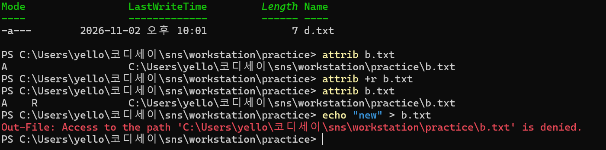

<sub>그림 05_file_permission : 파일을 <b>'읽기 전용(R)'</b>으로 바꿨어요. 쓰려고 하면 <b>Access is denied</b>(거부)가 나와요. 권한이 진짜 작동한다는 증거예요.</sub>

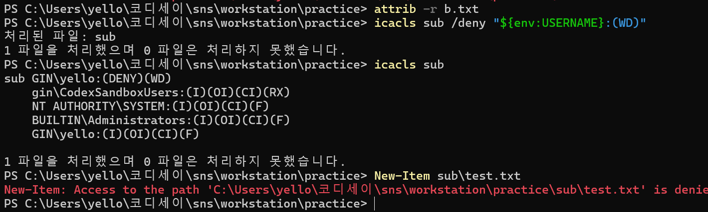

<sub>그림 06_dir_permission : 폴더에 <b>'쓰기 금지(DENY)'</b>를 걸었더니 새 파일을 만들 수 없어요.</sub>

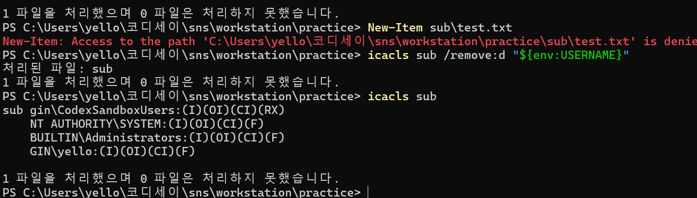

<sub>그림 07_dir_restore : 금지를 풀어서 <b>원래대로</b> 돌려놓았어요. (DENY가 사라졌어요.)</sub>


### 리눅스(ubuntu 안)에서 한 진짜 chmod

```text
chmod 644 f.txt     # 파일: rw-r--r--
chmod 700 d         # 폴더: rwx------
chmod 755 f.txt     # 파일: rwxr-xr-x
```

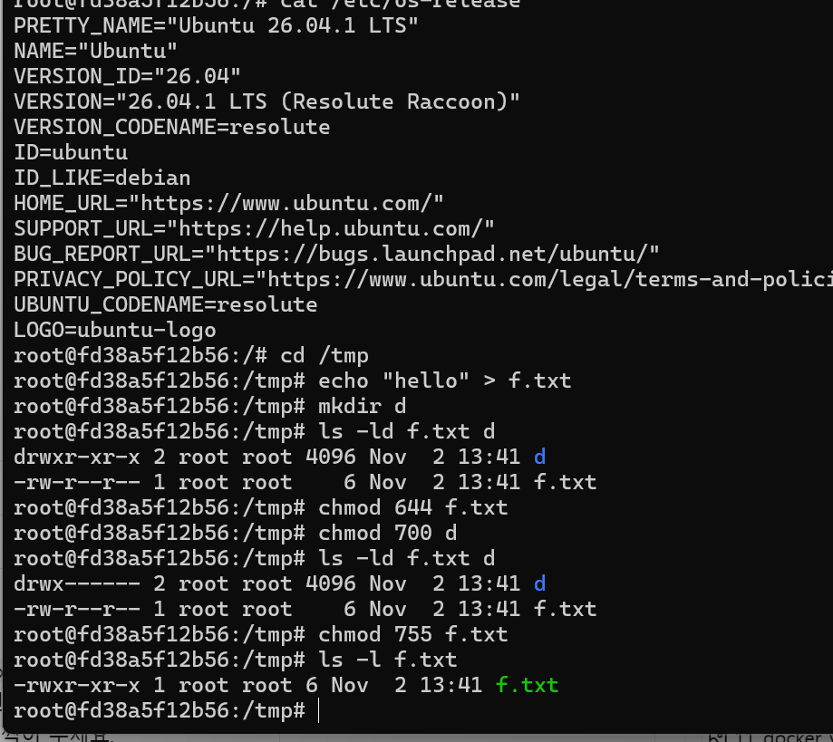

<sub>그림 17_chmod_linux : ubuntu 안에서 <b>chmod 644 / 700 / 755</b>를 하고 ls -l로 전과 후를 비교했어요. 폴더 d가 drwx------로, 파일이 -rwxr-xr-x로 바뀌었어요.</sub>

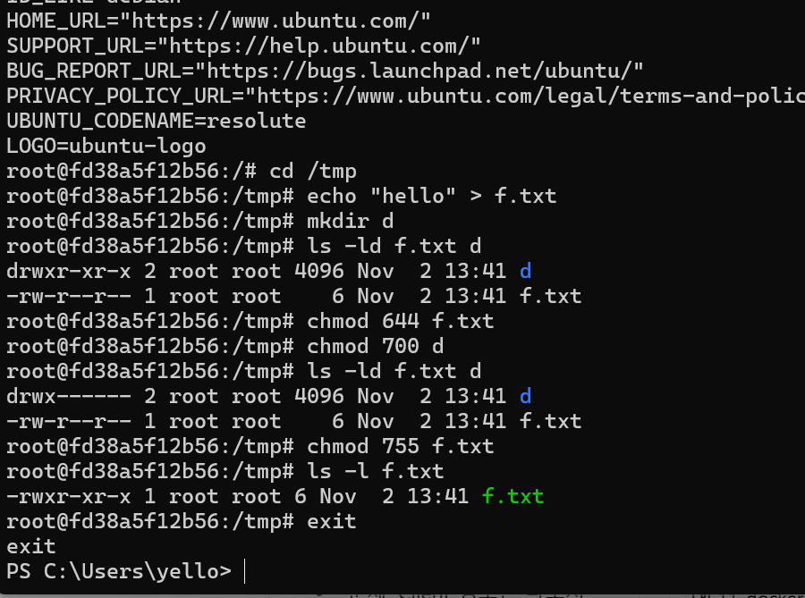

<sub>그림 17a_chmod_exit : exit를 치고 컨테이너에서 나와 Windows PowerShell로 돌아온 모습이에요.</sub>


---

## 4. Docker 준비 : 도시락 가게 문 열기

Docker는 프로그램을 <b>도시락처럼 포장</b>해요. 도시락 가게를 열려면 <b>설치</b>하고 <b>불을 켜야(엔진 실행)</b> 해요.

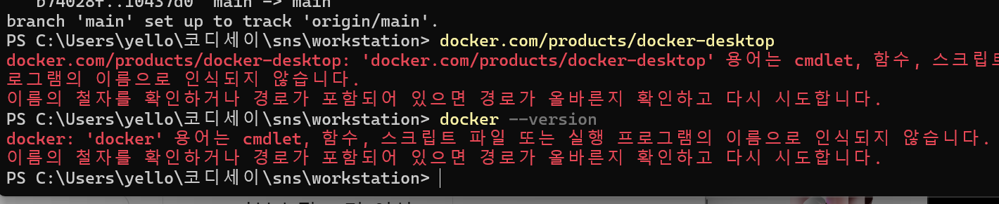

<sub>그림 09a_docker_before : 설치하기 <b>전</b>에는 docker라고 쳐도 "그런 명령은 몰라요"라고 나와요.</sub>

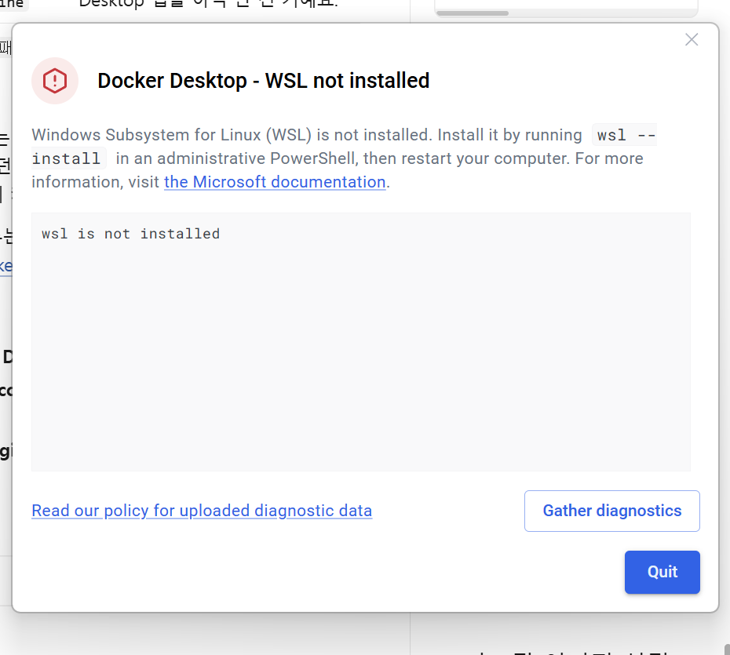

<sub>그림 12_wsl_not_installed : Docker Desktop을 켜자 <b>"WSL이 없어요"</b>라는 창이 떴어요. 도시락을 데울 <b>전자레인지(WSL)</b>가 없는 거예요.</sub>

```text
wsl --install         # 관리자 PowerShell에서 입력한 설치 명령 (이후 재부팅)
```

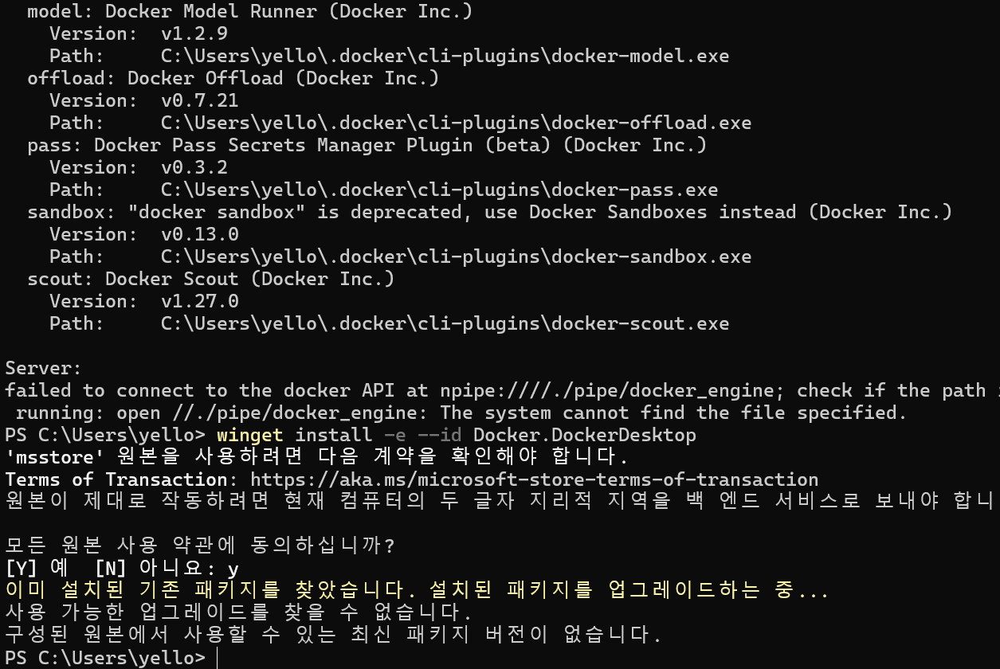

<sub>그림 10_docker_engine_off : docker info를 쳤더니 Client는 나오는데 <b>Server는 연결 실패</b>예요. 가게 불(엔진)이 꺼져 있었어요.</sub>

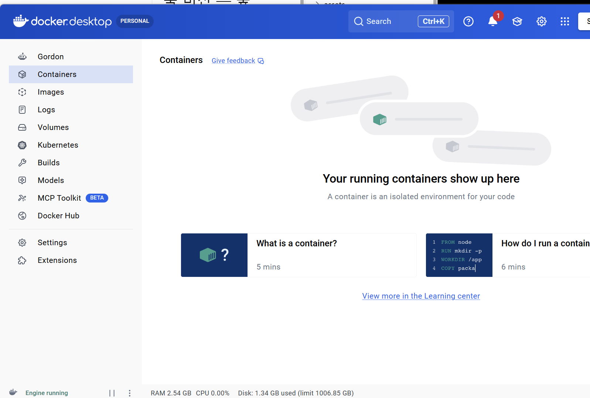

<sub>그림 11a_docker_desktop_running : Docker Desktop을 켜자 왼쪽 아래에 <b>Engine running</b>(엔진 켜짐)이 보여요.</sub>

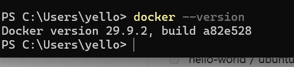

<sub>그림 11_docker_version : <b>docker --version</b> : Docker version 29.9.2</sub>

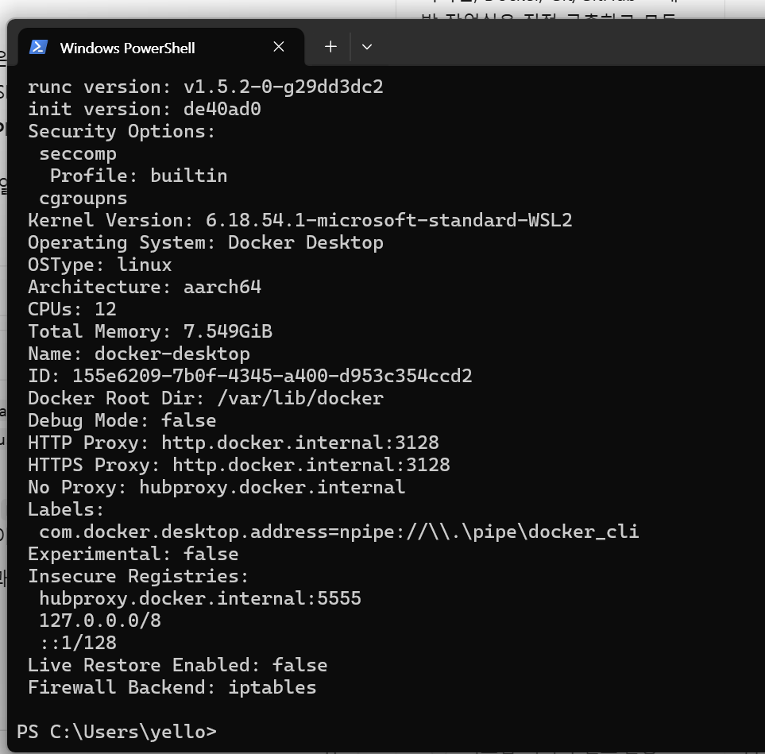

<sub>그림 11_docker_info_ok : <b>docker info</b> : 이제 Server 정보(리눅스, WSL2 등)가 나와요. 엔진이 켜졌다는 증거예요.</sub>


---

## 5. 첫 도시락 : hello-world와 ubuntu


### hello-world : 가장 작은 도시락

Docker가 잘 작동하는지 알려 주는 아주 작은 도시락이에요. <b>Hello from Docker!</b>가 나오면 성공이에요. 이 도시락은 인사만 하고 바로 끝나요.

```text
docker run hello-world
docker images       # 도시락 레시피(이미지) 목록
docker ps -a        # 도시락(컨테이너) 목록
```

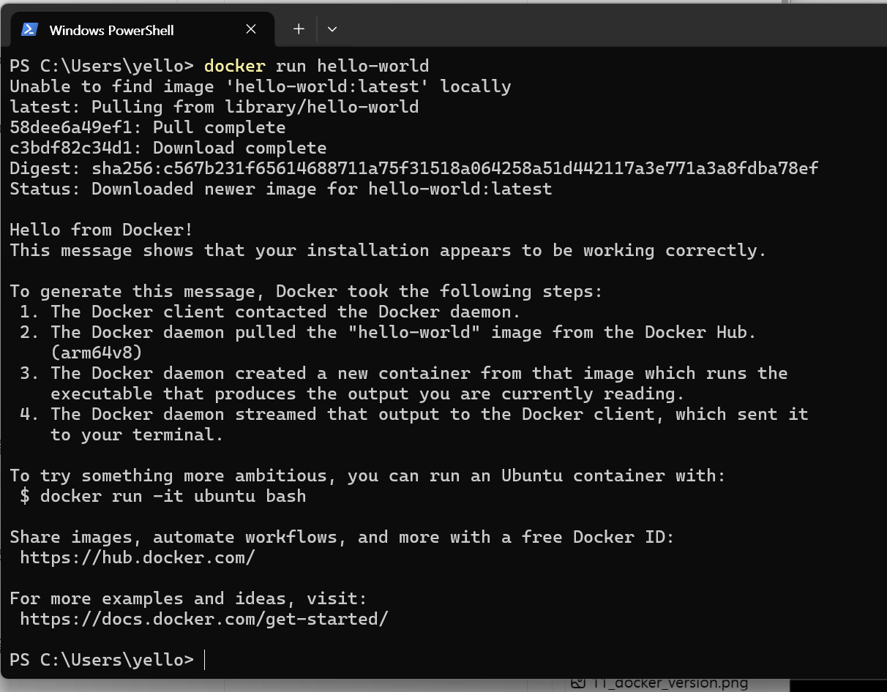

<sub>그림 14_hello_world : <b>Hello from Docker!</b> 성공! 처음 실행이라 이미지를 내려받는 과정(Pull complete)도 보여요.</sub>

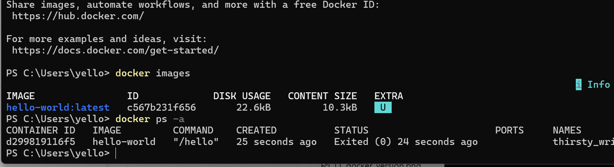

<sub>그림 15_images_ps : docker images에는 hello-world 레시피가, docker ps -a에는 <b>Exited (0)</b>(오류 없이 끝남) 도시락이 보여요.</sub>


### ubuntu : 안으로 들어가 보기

<b>ubuntu</b>는 리눅스예요. 도시락 <b>안으로 들어가서</b> ls, echo 같은 명령을 해 봤어요. 안에서는 화면 맨 앞이 <b>root@...</b>로 바뀌어요.

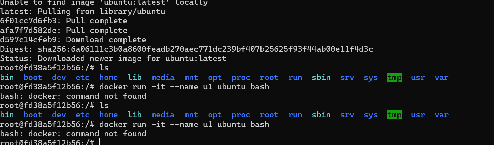

<sub>그림 16a_docker_inside_container_error : 도시락 <b>안에서</b> docker라고 쳤더니 <b>command not found</b>가 나왔어요. 안에는 docker가 없기 때문이에요. 바깥(Windows)에서 쳐야 해요.</sub>


### 들어가는 방법 두 가지, 나올 때 달라요

| 방법 | 하는 일 | exit 하면? |
|---|---|---|
| <b>run -it</b> | 새 도시락을 만들어서 들어가요 | 도시락이 <b>끝나요</b> (Exited) |
| <b>exec</b> | 이미 켜져 있는 도시락에 들어가요 | 도시락이 <b>계속 켜져 있어요</b> (Up) |

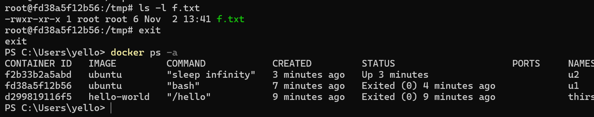

<sub>그림 18_ps_logs : docker ps -a : <b>u2는 Up(켜짐), u1과 hello-world는 Exited(끝남)</b>. 두 방법의 차이가 한눈에 보여요.</sub>

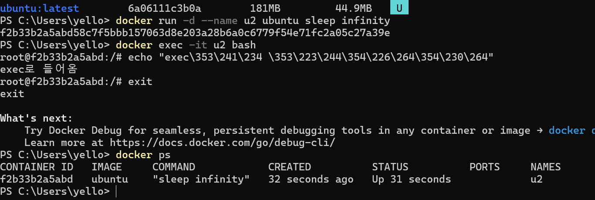

<sub>그림 19_exec_vs_run : <b>exec</b>로 u2에 들어갔다 나와도 docker ps에 u2가 <b>Up</b>으로 남아 있어요.</sub>

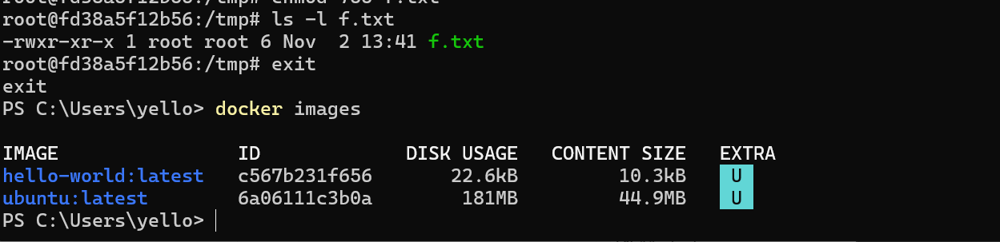

<sub>그림 18a_images_after_exit : 나온 뒤 docker images : hello-world와 ubuntu 두 레시피가 보여요.</sub>


### 가게 상태 살피기

```text
docker logs u1                # 도시락이 남긴 기록 보기
docker stats --no-stream     # 힘(CPU)·기억(메모리) 얼마나 쓰나?
```

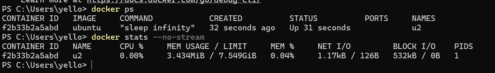

<sub>그림 20_docker_stats : docker stats : u2가 <b>CPU 0.00%, 메모리 약 3MB</b>만 쓰고 있어요. 아주 가벼워요.</sub>


---

## 6. 내 레시피 : Dockerfile과 이미지

<b>Dockerfile</b>은 도시락을 만드는 <b>레시피 카드</b>예요. 이미 있는 레시피(nginx)에 내 것을 조금 더해서 <b>내 이미지</b>를 만들었어요.

```text
FROM nginx:alpine                           # 바탕 레시피: 웹 서버 nginx
LABEL org.opencontainers.image.title="forest-guide-web"   # 이름표
ENV APP_ENV=dev                            # 환경 구분 값
COPY site/ /usr/share/nginx/html/          # 내 숲해설 안내 페이지로 바꾸기
```

| 줄 | 하는 일 | 비유 |
|---|---|---|
| FROM | 바탕이 될 이미지를 골라요 | 기본 레시피 가져오기 |
| LABEL | 이미지에 이름표를 붙여요 | 도시락통에 이름 쓰기 |
| ENV | 환경 값을 정해요 (dev=개발용) | '오늘은 연습용' 표시 |
| COPY | 내 페이지를 웹 서버 자리에 넣어요 | 내 반찬 넣기 |

```text
docker build -t forest-web:1.0 .      # 내 이미지 만들기 (맨 끝 점(.)은 '이 폴더에서'라는 뜻)
```

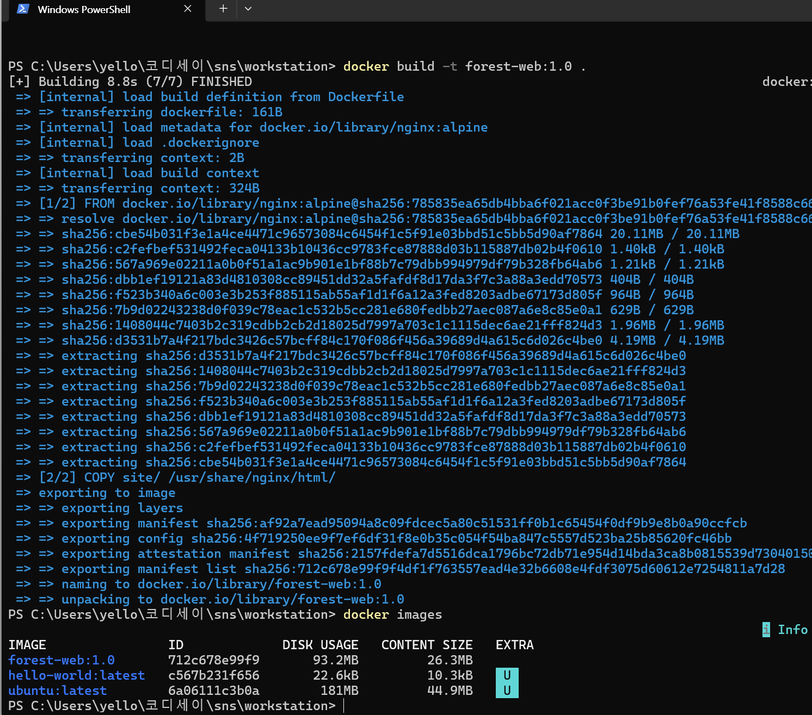

<sub>그림 21_docker_build : <b>내 이미지 forest-web:1.0</b>이 만들어졌어요. docker images에 93MB짜리로 보여요.</sub>


---

## 7. 정문 번호 : 포트 매핑

도시락 가게는 <b>문이 닫힌 방</b>이라, 밖에서 바로 들어올 수 없어요. 그래서 <b>정문 번호를 안쪽 방에 연결</b>해 줘야 해요. 그게 <b>포트 매핑</b>이에요.

```text
docker run -d -p 8080:80 --name forest-8080 forest-web:1.0
docker run -d -p 8081:80 --name forest-8081 forest-web:1.0
#                  ^내 PC 정문   ^도시락 안쪽 방
```

> <b>-p 8080:80</b> = "내 컴퓨터의 <b>8080번 문</b>으로 오면 도시락 안 <b>80번 방</b>으로 안내해 줘!"<br>정문 번호만 바꾸면(8080, 8081) <b>같은 레시피로 도시락을 여러 개</b> 만들 수 있어요.

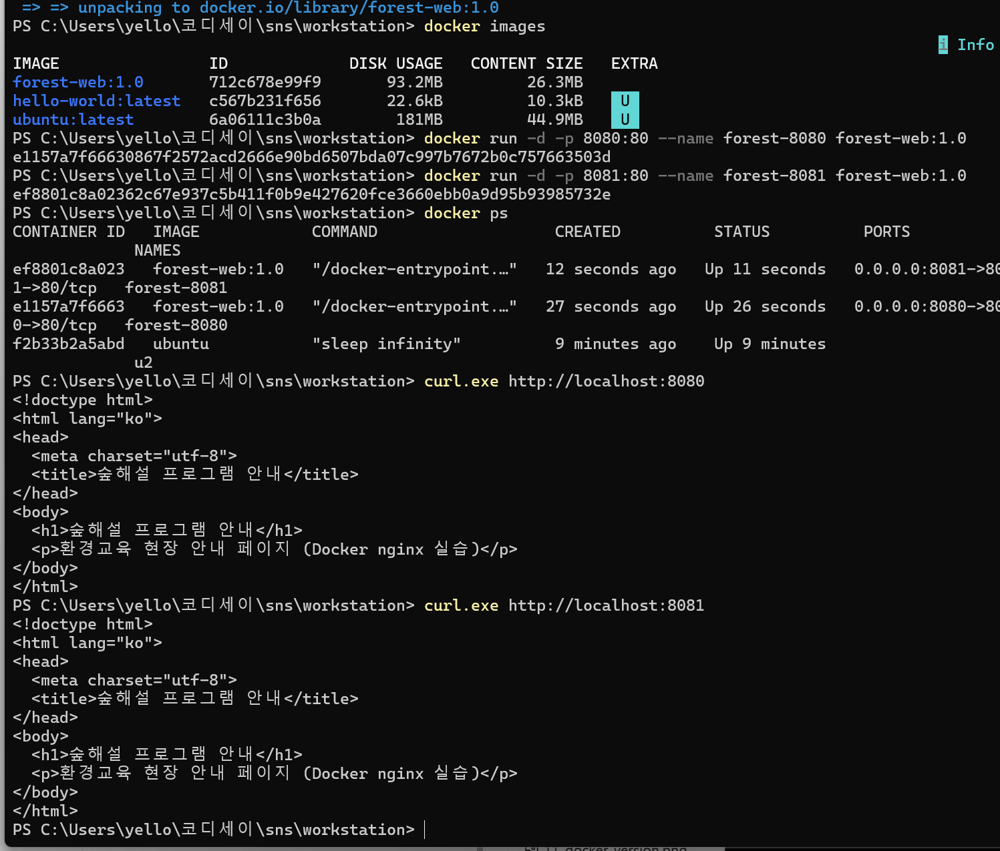

<sub>그림 22_port_mapping : 같은 이미지로 <b>컨테이너 2개</b>가 켜졌어요. PORTS에 8080->80, 8081->80이 보이고, curl로 두 곳 모두 숲해설 페이지가 나와요.</sub>

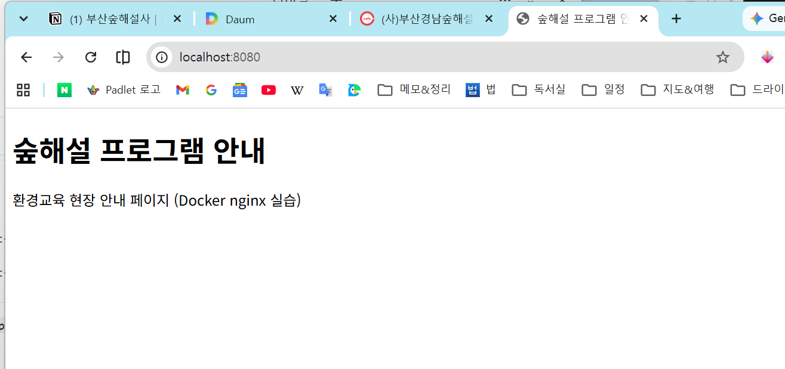

<sub>그림 23_browser_8080 : 브라우저 <b>주소창에 localhost:8080</b>이 보여요. 숲해설 프로그램 안내 페이지가 나와요.</sub>

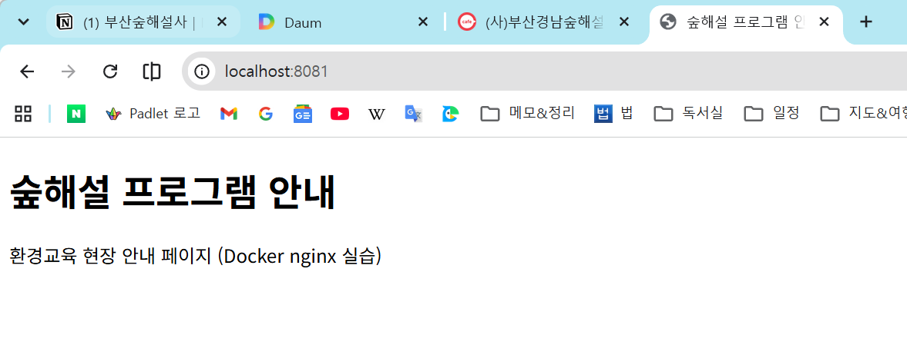

<sub>그림 24_browser_8081 : <b>localhost:8081</b>도 같은 페이지예요. 정문만 다른 같은 도시락이에요.</sub>


### 가게 불이 꺼졌을 때

나중에 브라우저가 <b>연결 거부(ERR_CONNECTION_REFUSED)</b>를 보여 줬어요. 정문 앞에 갔는데 아무도 없는 거예요. 이유는 Docker 엔진이 꺼져서 도시락도 함께 멈췄기 때문이에요. 도시락은 <b>지워진 게 아니라 멈춰 있을 뿐</b>이라 다시 켰어요.

```text
docker start forest-8080 forest-8081     # 멈춘 도시락 다시 켜기
```

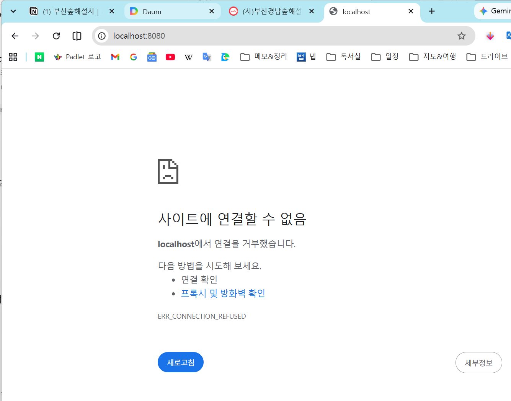

<sub>그림 25_connection_refused : 브라우저의 <b>연결 거부</b> 화면 (엔진이 꺼져 있을 때).</sub>

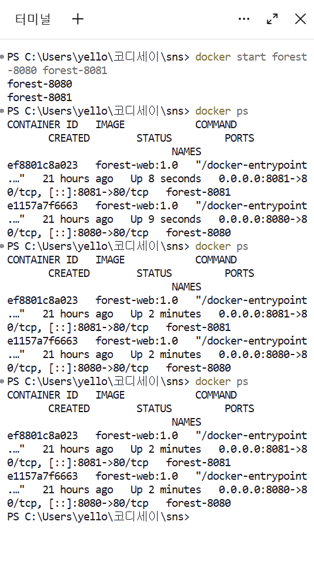

<sub>그림 26_docker_start_ok : docker start 뒤 docker ps : 두 컨테이너가 <b>Up</b>이고 포트도 그대로예요.</sub>


---

## 8. 창문과 사물함 : 바인드 마운트, 볼륨

| 이름 | 쉬운 말 | 비유 | 언제 쓰나요? |
|---|---|---|---|
| <b>바인드 마운트</b> | 내 컴퓨터 폴더와 도시락 안 폴더를 <b>한 창문</b>으로 이어요 | 같은 창문으로 같은 방 보기 | 고치면 <b>바로 바뀌어 보여야</b> 할 때(개발) |
| <b>볼륨</b> | Docker가 관리하는 <b>보관함</b>이에요 | 은행 사물함 | 도시락을 버려도 <b>남겨야</b> 하는 데이터 |


### 바인드 마운트 : 고치면 바로 바뀌어요

```text
docker run -d -p 8082:80 --name bind-test -v "${PWD}\site:/usr/share/nginx/html" nginx:alpine
# 내 PC의 site 폴더 <-> 도시락 안 /usr/share/nginx/html
```

내 컴퓨터에서 <b>index.html을 고친 뒤</b> 도시락을 다시 만들지 않았는데, 접속하면 <b>바뀐 내용</b>이 나왔어요.

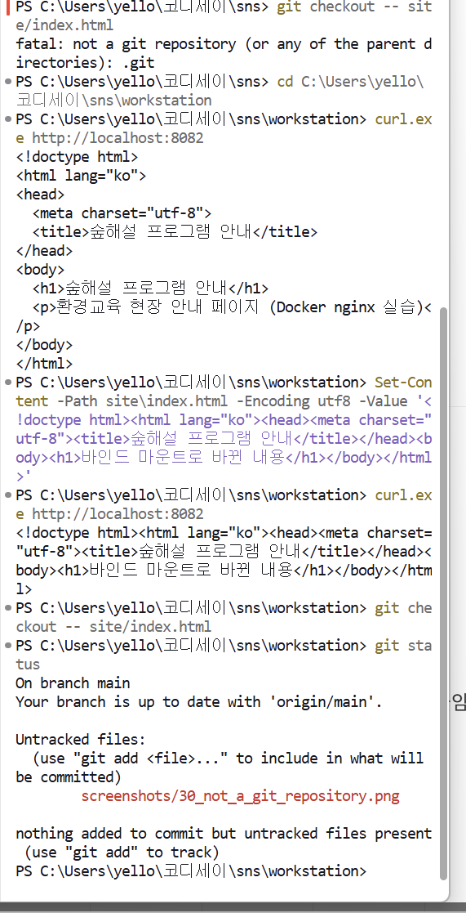

<sub>그림 27_bind_mount_before_after : <b>바뀌기 전</b>은 '숲해설 프로그램 안내', <b>고친 후</b>는 '바인드 마운트로 바뀐 내용'이 나와요. 도시락은 그대로인데 내용이 바뀌었어요.</sub>


### 볼륨 : 도시락을 버려도 남아요

1) 사물함(mydata)에 쪽지 <b>forest-note</b>를 넣고, 2) 도시락을 <b>버리고</b>, 3) 새 도시락에 같은 사물함을 연결하고, 4) 쪽지가 그대로인지 봤어요.

```text
docker volume create mydata
docker run -d --name vol-test -v mydata:/data ubuntu sleep infinity
docker exec vol-test bash -c "echo forest-note > /data/hello.txt && cat /data/hello.txt"
docker rm -f vol-test                 # 도시락 버리기!
docker run -d --name vol-test2 -v mydata:/data ubuntu sleep infinity
docker exec vol-test2 cat /data/hello.txt     # forest-note 가 그대로!
```

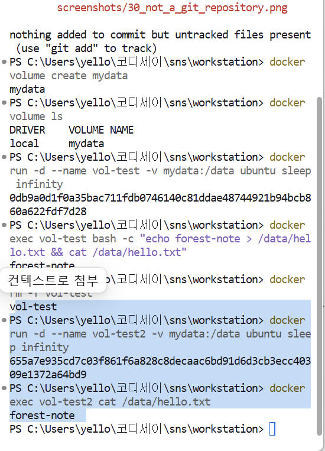

<sub>그림 32_volume_persist : 도시락(vol-test)을 지웠는데 새 도시락(vol-test2)에서 <b>forest-note</b>가 그대로 나왔어요. 데이터가 남는다는 증거예요.</sub>


---

## 9. 일기장과 클라우드 : Git과 GitHub

<b>Git</b>은 내 컴퓨터의 일기장이에요. 무엇을 바꿨는지 한 장씩 기록해요. <b>GitHub</b>는 그 일기장을 인터넷에 올려 두는 사물함이에요.

> <b>택배 보내기 순서</b> : <b>add</b>(상자에 담기) → <b>commit</b>(송장 붙여 저장) → <b>push</b>(택배 보내기)

```text
git init                     # 새 일기장 만들기
git remote add origin ...    # 클라우드 사물함 주소 적어 두기
git add README.md            # 상자에 담기
git commit -m "설명"          # 저장하고 이름 붙이기
git push                     # GitHub로 보내기
```

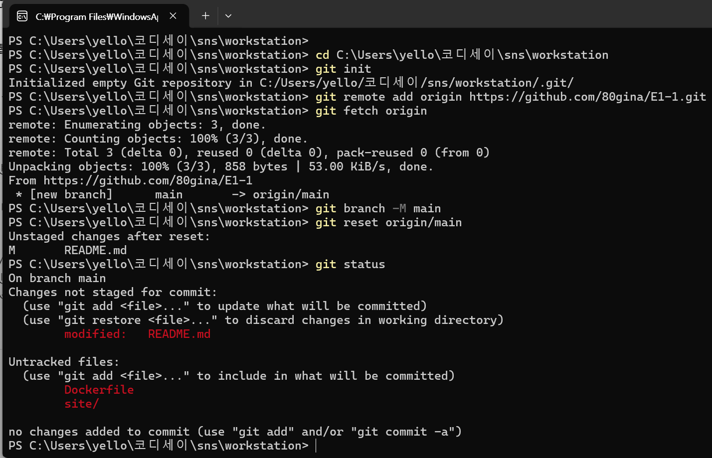

<sub>그림 02_git_remote_status : Git 일기장을 만들고(<b>git init</b>) GitHub 주소를 연결했어요(remote add). 아직 안 담은 파일이 빨간색으로 보여요.</sub>

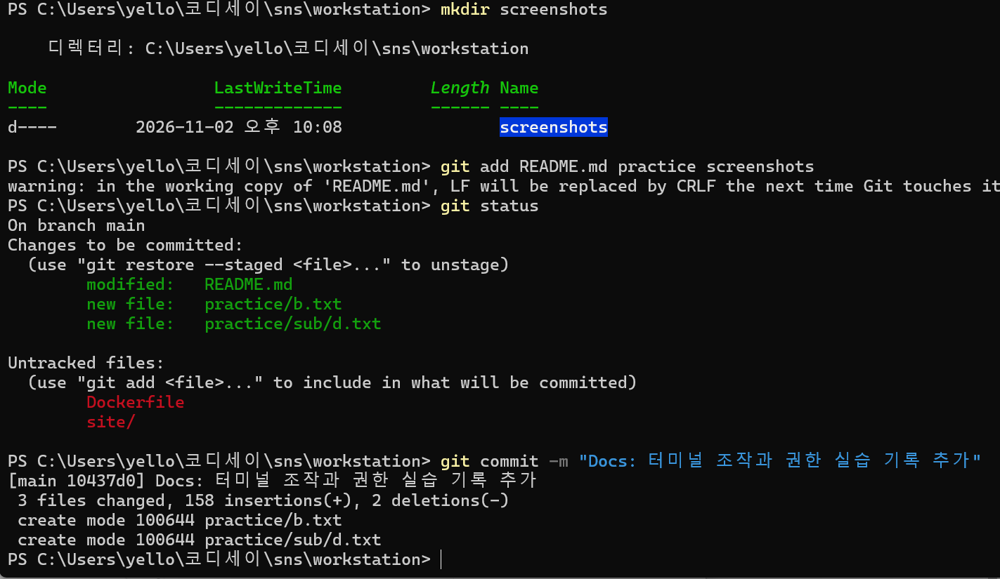

<sub>그림 08a_git_add_commit : <b>add</b>로 담고 <b>commit</b>으로 저장했어요. 빨간 untracked 파일은 일부러 담지 않은 것들이에요.</sub>

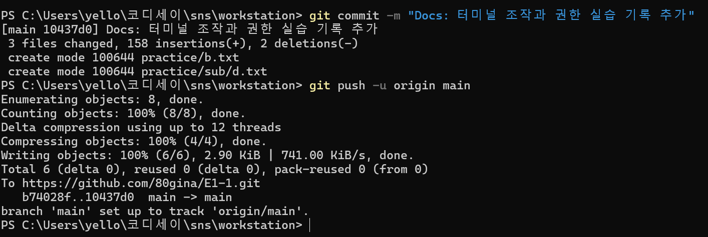

<sub>그림 08_first_push : 처음으로 GitHub에 올렸어요(<b>push</b>). main -> main이 보이면 성공이에요.</sub>

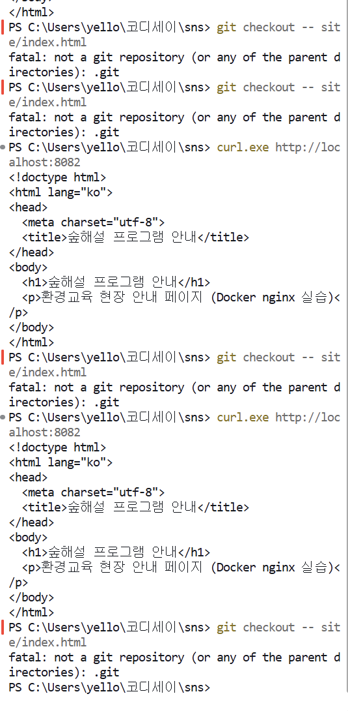

<sub>그림 30_not_a_git_repository : 엉뚱한 폴더(일기장이 없는 곳)에서 git을 쳤더니 <b>not a git repository</b>가 나왔어요. 폴더를 옮겨서 해결했어요.</sub>


### Git 설정 확인 (개인정보는 가렸어요)

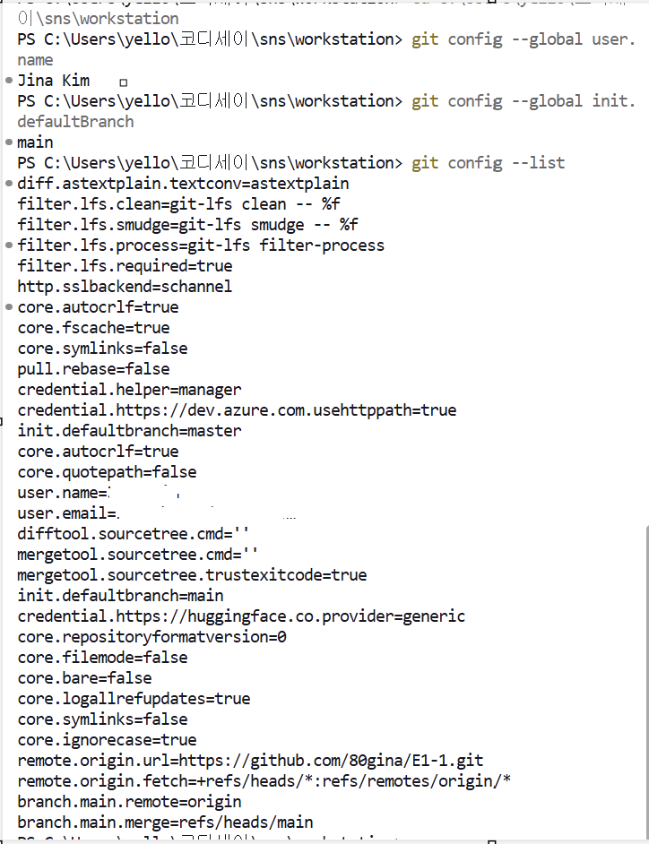

<sub>그림 33_git_config : <b>git config --list</b> : 기본 브랜치가 main이고, <b>이름과 이메일은 가렸어요</b>. 저장소 주소도 보여요.</sub>

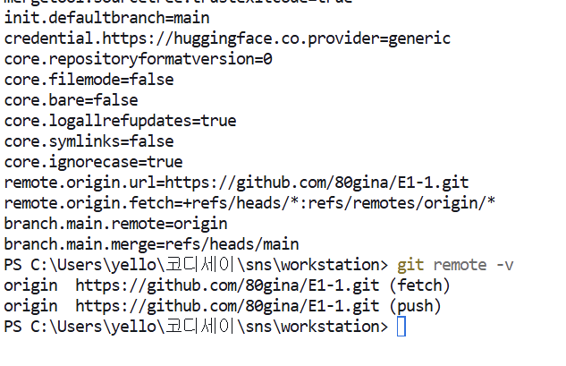

<sub>그림 34_git_remote : <b>git remote -v</b> : origin이 GitHub의 E1-1 저장소를 가리켜요.</sub>


### VSCode와 GitHub 연결

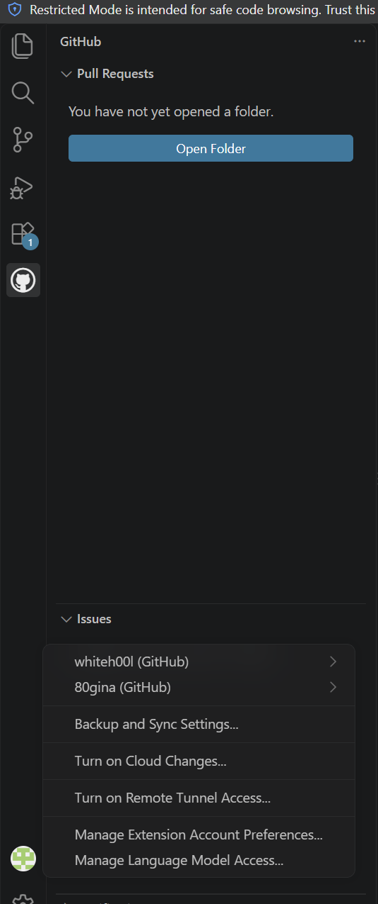

<sub>그림 35_vscode_github : VSCode 계정 메뉴에 <b>80gina (GitHub)</b>로 로그인된 모습이에요.</sub>

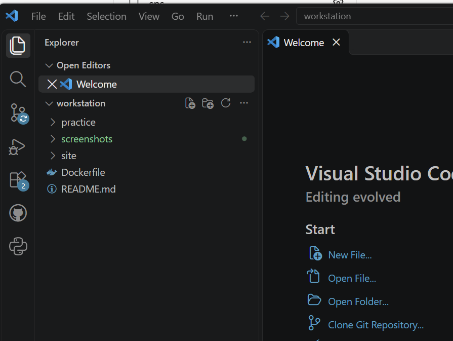

<sub>그림 36a_vscode_explorer : VSCode에서 <b>workstation 폴더</b>를 열었어요. 왼쪽에 파일 목록이 보여요.</sub>

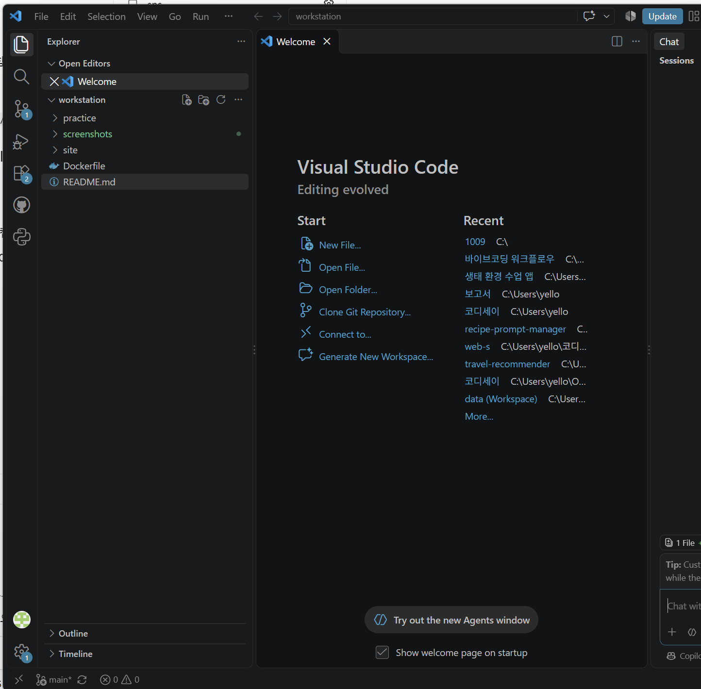

<sub>그림 36_vscode_source_control : VSCode 아래쪽에 <b>main</b> 브랜치가 보여요. 저장소와 잘 연결됐다는 뜻이에요.</sub>


---

## 10. 보너스 1~4 : Docker Compose와 환경 변수

<b>Compose</b>는 긴 docker run 명령을 <b>레시피 카드 한 장(docker-compose.yml)</b>에 적어 두는 거예요. 누구나 <b>docker compose up -d</b> 한 줄로 똑같이 만들 수 있어요.


### 보너스 1 : 한 개짜리 Compose

```text
services:
  web:
    image: nginx:alpine
    ports:
      - "8090:80"
    volumes:
      - ../../site:/usr/share/nginx/html:ro
```

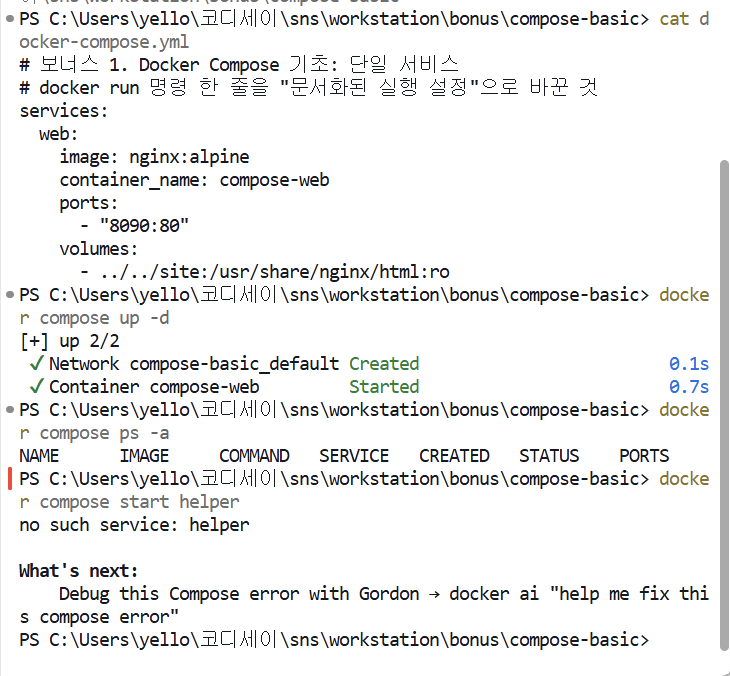

<sub>그림 40_compose_basic : 설정 파일을 <b>cat</b>으로 보고 <b>docker compose up -d</b>로 켰어요.</sub>

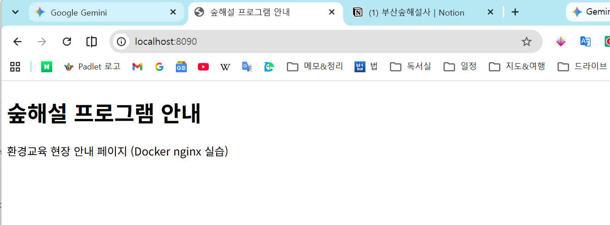

<sub>그림 41_compose_basic_browser : 브라우저 <b>localhost:8090</b> 접속 성공.</sub>

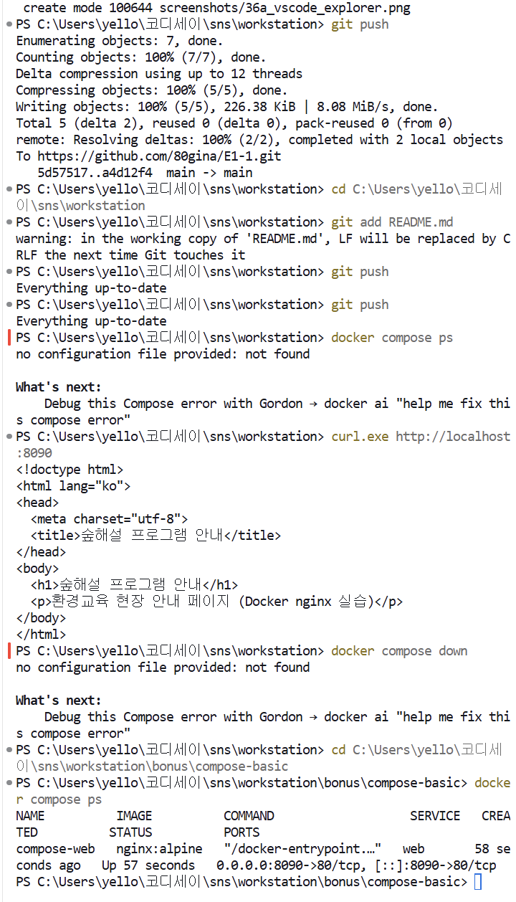

<sub>그림 42_compose_no_config_fix : 처음엔 <b>설정 파일이 없는 폴더</b>에서 ps를 쳐서 'no configuration file'이 나왔고, <b>폴더를 옮기자</b> compose-web이 Up으로 보였어요.</sub>

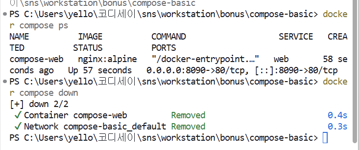

<sub>그림 43_compose_down : <b>docker compose down</b> : 도시락과 전용 길(네트워크)이 정리됐어요.</sub>


### 보너스 2 : 도시락 두 개가 서로 이름으로 부르기

<b>web</b>(내 페이지)과 <b>helper</b>(도우미)를 함께 켰어요. Compose는 둘을 <b>같은 길로 이어 주고</b> 서로를 <b>이름</b>으로 부를 수 있게 해 줘요.

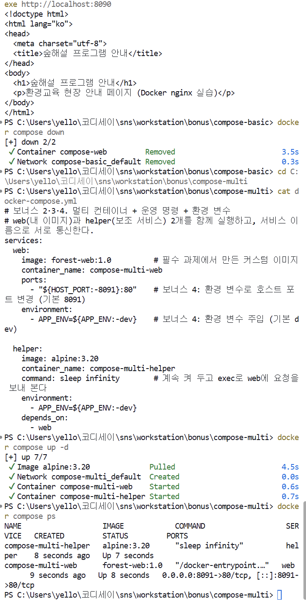

<sub>그림 44_compose_multi_up : docker compose up -d 로 <b>web과 helper가 함께 Started</b> 됐어요. 둘 다 Up이에요.</sub>

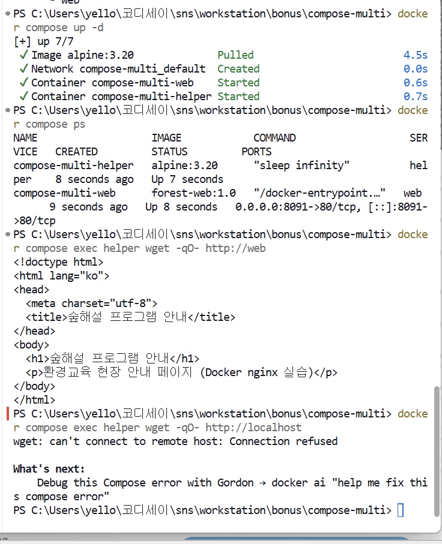

<sub>그림 45_compose_multi_network : helper가 <b>http://web</b>으로 부르면 성공(HTML이 와요), <b>http://localhost</b>로 부르면 거부(Connection refused)예요. 도시락 안의 localhost는 <b>자기 자신</b>이라서요.</sub>


### 보너스 3 : 가게 상태 확인 루틴 (up, ps, logs, down)

```text
docker compose up -d       # 켜기
docker compose ps          # 출석 확인
docker compose logs web    # 기록 보기
docker compose down        # 끄기
```

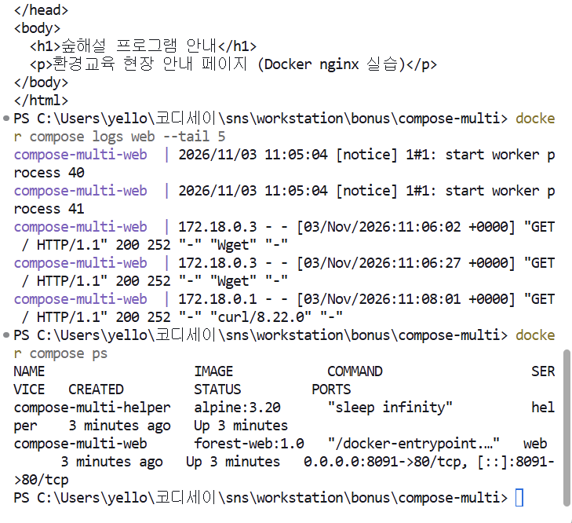

<sub>그림 47_compose_ops_logs : <b>logs</b> : web이 받은 요청 기록이 나와요. 누가 요청했는지(Wget, curl)까지 알 수 있어요.</sub>

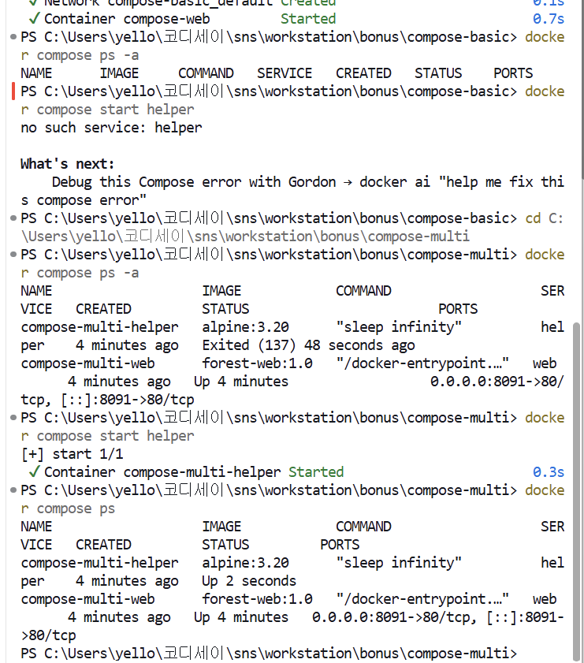

<sub>그림 48_compose_ops_stop_start : <b>helper만 멈췄다(Exited) 다시 켜기(Up)</b>. web은 계속 켜져 있었어요.</sub>


### 보너스 4 : 레시피는 그대로, 옵션표만 바꾸기

<b>환경 변수</b>로 포트(8091→8095)와 모드(dev→prod)를 바꿨어요. <b>파일을 한 글자도 고치지 않았어요.</b> 이렇게 '설정'과 '레시피'를 나누는 걸 <b>설정과 코드의 분리</b>라고 해요.

```text
$env:HOST_PORT="8095"       # 이 창에서만 쓰는 임시 값
$env:APP_ENV="prod"
docker compose up -d
```

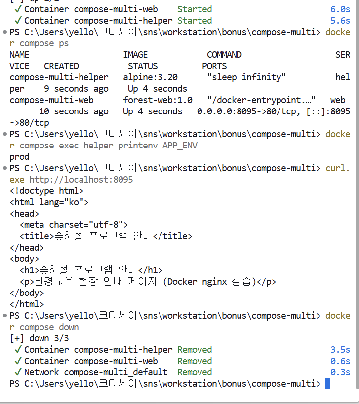

<sub>그림 49_compose_env_override : 바꾼 값으로 켜서 확인한 뒤 down까지 한 전체 흐름이에요. 포트가 <b>8095</b>, 모드가 <b>prod</b>예요.</sub>

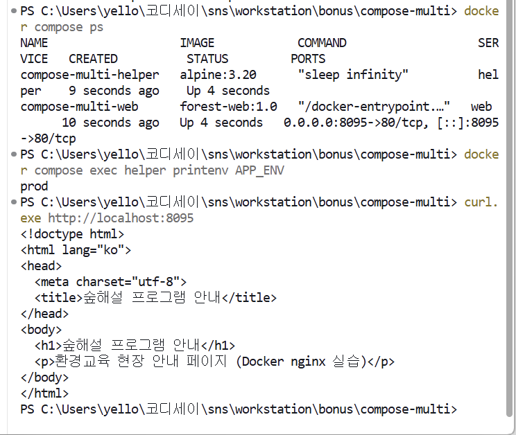

<sub>그림 49a_compose_env_check : <b>ps에 8095->80</b>, <b>printenv APP_ENV가 prod</b>, <b>curl로 8095 접속 성공</b>.</sub>

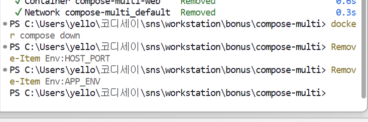

<sub>그림 50_compose_env_cleanup : 임시 값 지우기(Remove-Item Env:...)까지 <b>오류 없이</b> 끝났어요.</sub>


---

## 11. 보너스 5 : SSH 열쇠와 자물쇠

지금까지는 GitHub에 올릴 때 <b>신분증(로그인)</b>을 보여 줬어요. 이번엔 <b>열쇠와 자물쇠</b>를 써 봤어요.

| 이름 | 비유 | 어디에 두나요? | 남에게 보여 줘도 되나요? |
|---|---|---|---|
| <b>공개키</b> (.pub) | 자물쇠 | GitHub 사물함에 달아 둬요 | <b>네</b>, 괜찮아요 |
| <b>개인키</b> | 열쇠 | <b>내 컴퓨터 안에만</b> | <b>절대 안 돼요!</b> |

> <b>지킨 약속</b> : 열쇠(개인키)는 화면에도, 문서에도, 저장소에도 <b>올리지 않았어요.</b> 공개키와 지문만 보여요.

```text
ssh-keygen -t ed25519 -C "github-ssh-e1"    # 열쇠와 자물쇠 한 쌍 만들기
ssh -T git@github.com                       # 열쇠로 열리는지 시험
git remote set-url origin git@github.com:80gina/E1-1.git   # 올리는 길을 SSH로 바꾸기
```

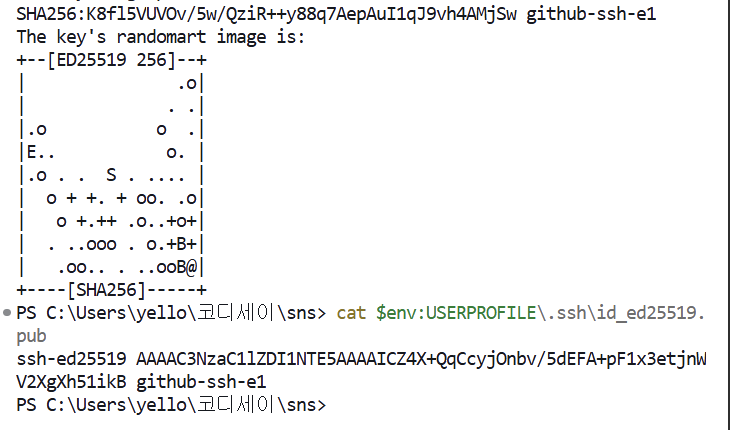

<sub>그림 51_ssh_keygen : 열쇠 한 쌍을 만들고 <b>공개키(.pub)</b> 한 줄과 지문을 확인했어요.</sub>


<sub>그림 52_github_ssh_key_added : GitHub에 자물쇠를 달았어요. 이름 <b>내 윈도우 PC</b>와 <b>지문</b>이 보여요. 터미널에서 본 지문과 같아요.</sub>


<sub>그림 53_ssh_test : <b>Hi 80gina!</b> 열쇠로 사물함이 열렸어요.</sub>


<sub>그림 54_ssh_remote : 올리는 주소가 <b>git@github.com:80gina/E1-1.git</b>(SSH)로 바뀌었어요.</sub>


<sub>그림 55_ssh_push : <b>To github.com:80gina/E1-1.git</b> : SSH로 push에 성공했어요. 비밀번호 없이요.</sub>


---

## 12. 포트가 겹치면? 직접 일으켜 본 실험

같은 정문 번호(8080)를 <b>두 도시락에</b> 연결하려고 하면 어떻게 될까요? 일부러 해 봤어요. <b>한 번호는 한 곳에만</b> 쓸 수 있어요.

```text
docker run -d -p 8080:80 --name conflict-a nginx:alpine   # 8080 차지
docker run -d -p 8080:80 --name conflict-b nginx:alpine   # 같은 번호! -> 실패
```


<sub>그림 56_port_conflict_error : 두 번째에서 <b>Bind for 0.0.0.0:8080 failed: port is already allocated</b> (이미 사용 중이에요)라는 오류가 나왔어요. 일부러 일으킨 오류라 정상이에요.</sub>


### 누가 쓰고 있을까? 조사하는 순서

| 순서 | 할 일 | 명령 |
|---|---|---|
| 1 | 오류 메시지에서 <b>어떤 번호</b>인지 읽어요 | 8080 |
| 2 | Docker 안에서 쓰는지 봐요 | docker ps  (PORTS 칸) |
| 3 | 컴퓨터 전체에서 쓰는지 봐요 | netstat -ano \| findstr ":8080" |
| 4 | 그 번호(PID)가 어떤 프로그램인지 봐요 | tasklist /FI "PID eq 10576" |
| 5 | 고쳐요: 쓰는 쪽을 멈추거나 <b>내 번호를 바꿔요</b> | -p 8090:80 |


<sub>그림 57_port_conflict_diagnosis : 조사와 해결의 전체 흐름이에요. <b>LISTENING 10576</b>이 8080을 잡고 있고, 번호를 <b>8090</b>으로 바꾸자 두 도시락이 동시에 Up이에요.</sub>


<sub>그림 57a_port_conflict_pid : PID <b>10576</b>은 <b>com.docker.backend.exe</b> (Docker 자신)였어요.</sub>

> <b>새로 알게 된 것</b> : 실패한 도시락(conflict-b)은 <b>Created 상태로 남아요</b>. 그래서 <b>docker rm</b>으로 정리해야 해요. 또, 처음에 명령에 <b>'숫자'라는 글자</b>를 그대로 넣었다가 오류가 났어요. 진짜 번호(10576)로 바꿔 넣어 해결했어요.


---

## 13. 어려웠던 일과 해결 방법

오류는 <b>고장이 아니라 "여기를 확인해 봐!"라는 안내</b>예요. 만난 오류와 푼 방법이에요.

| 오류 | 쉬운 말 | 해결 |
|---|---|---|
| failed to connect to the docker API | 도시락 가게의 <b>불이 꺼져</b> 있어요 | Docker Desktop을 켰어요 (그림 10, 11a) |
| WSL not installed | 도시락을 데울 <b>전자레인지가 없어요</b> | wsl --install 후 재부팅 (그림 12) |
| ERR_CONNECTION_REFUSED | 정문 앞에 갔는데 <b>아무도 없어요</b> | docker start로 다시 켰어요 (그림 25, 26) |
| docker: command not found (도시락 안) | 안에는 <b>docker가 없어요</b> | exit로 나와서 바깥에서 입력 (그림 16a) |
| not a git repository | <b>엉뚱한 서랍</b>을 열었어요 | 맞는 폴더로 cd (그림 30) |
| no configuration file provided / no such service | <b>다른 카드 상자</b>에서 레시피를 찾았어요 | compose 파일이 있는 폴더로 이동 (그림 42) |
| port is already allocated (일부러) | 같은 정문 번호를 <b>두 번</b> 썼어요 | 번호를 바꿨어요 (그림 56, 57) |

> 가장 자주 한 실수는 <b>"지금 내가 어느 폴더에 있는지 안 보고 명령을 친 것"</b>이에요. 그래서 명령을 치기 전에 <b>화면 맨 끝의 폴더 이름</b>을 먼저 보는 습관을 들였어요.


---

## 14. 질문과 쉬운 대답


### Q1. 이미지와 컨테이너는 뭐가 달라요?

|  | 이미지 | 컨테이너 |
|---|---|---|
| <b>만들 때</b> | docker build로 <b>만들어요</b> (레시피) | 이미지로 docker run해서 <b>생겨요</b> (도시락) |
| <b>움직일 때</b> | 움직이지 않아요. 읽기만 돼요. | 실제로 <b>움직여요</b> |
| <b>바꿀 때</b> | 고치려면 다시 build해서 <b>새 이미지</b> | 안에서 바꾼 건 그 도시락에만. 버리면 사라져요 |

레시피 하나(forest-web:1.0)로 도시락 두 개(forest-8080, forest-8081)를 만들었어요. (그림 22~24)


### Q2. 도시락 안 번호로 왜 바로 못 들어가요? 포트 매핑은 왜 필요해요?

도시락은 <b>자기만의 닫힌 방</b>에서 움직여요. 안에서 80번 문을 열어도 내 컴퓨터의 80번 문과는 다른 방이에요. 그래서 <b>-p 내번호:안쪽번호</b>로 연결해 줘야 브라우저가 들어갈 수 있어요. 내 번호만 바꾸면 같은 도시락을 여러 개 켤 수 있어요.


### Q3. 절대 경로와 상대 경로는 언제 써요?

|  | 모양 | 비유 | 이럴 때 |
|---|---|---|---|
| <b>절대 경로</b> | C:\Users\yello\... | '부산시 ○○구 ○○동 3번지' | 어디서 시작하든 <b>똑같은 곳</b>을 가리켜야 할 때 |
| <b>상대 경로</b> | site\index.html | '우리 집에서 옆 건물' | 프로젝트 안에서 <b>어디에 옮겨 놔도</b> 동작해야 할 때 |


### Q4. 755, 644는 어떻게 읽어요?

읽기=4, 쓰기=2, 실행=1을 더해서 <b>주인 / 모둠 / 다른 사람</b> 순서로 써요. <b>755</b> = 7(전부) 5(읽기+실행) 5(읽기+실행), <b>644</b> = 6(읽기+쓰기) 4(읽기) 4(읽기)예요. (그림 17)


### Q5. 포트가 이미 쓰이고 있으면 어떤 순서로 알아봐요?

<b>① 메시지에서 번호 읽기 → ② docker ps로 Docker 안 확인 → ③ netstat로 컴퓨터 전체 확인 → ④ tasklist로 PID가 누군지 확인 → ⑤ 쓰는 쪽을 멈추거나 내 번호를 바꾸기.</b> 직접 해 봤어요. (그림 56, 57, 57a)


### Q6. 컨테이너를 지웠더니 데이터가 사라지면 어떻게 막아요?

- <b>볼륨</b> : 도시락과 따로 보관해요. (그림 32)
- <b>바인드 마운트</b> : 내 컴퓨터 폴더에 직접 두어요. (그림 27)
- <b>백업</b> : 볼륨 내용을 파일로 따로 저장해 둬요.

주의: <b>docker compose down -v</b>나 <b>docker volume rm</b>은 사물함까지 지워요.


### Q7. 가장 어려웠던 일은 뭐였고, 어떻게 풀었어요?

| 단계 | 내용 |
|---|---|
| <b>증상</b> | 브라우저가 localhost:8080 연결을 거부했어요. (그림 25) |
| <b>가설(추측)</b> | ① 도시락이 꺼졌나? ② 포트 연결이 틀렸나? ③ 엔진이 꺼졌나? |
| <b>확인</b> | docker ps -a에서 Exited (255), docker info도 연결 실패 → ①과 ③이 맞고 ②는 아니에요. |
| <b>조치</b> | Docker Desktop을 켜고 docker start로 다시 켰어요. (그림 26) |
| <b>결과</b> | 접속이 다시 됐어요. (그림 23) 엔진이 꺼져도 도시락은 지워지지 않고 멈춰 있을 뿐이에요. |


### Q8. Git과 GitHub는 뭐가 달라요?

<b>Git</b>은 내 컴퓨터에서 바뀐 내용을 기록하는 도구(일기장)이고, <b>GitHub</b>는 그 기록을 인터넷에 올려 공유하고 같이 일하는 곳(클라우드 사물함)이에요.


---

## 15. 평가 문항 찾아보기

| 평가 항목 | 확인할 것 | 이 문서의 장 | 증거 그림 |
|---|---|---|---|
| <b>1. 기능 동작</b> | 폴더·파일 만들기, 옮기기, 지우기 | 2장 | 01, 03, 04 |
|  | 권한 변경 결과 | 3장 | 05, 06, 07, 17 |
|  | docker --version, 동작 상태 | 4장 | 11_docker_version, 11_docker_info_ok |
|  | hello-world 실행 | 5장 | 14 |
|  | 이미지/컨테이너 목록, 정리 | 5장, 8장, 10장 | 15, 18, 18a, 20, 32, 43 |
|  | Dockerfile로 빌드 | 6장 | 21 |
|  | 매핑된 포트로 접속 | 7장 | 22, 23, 24 |
|  | 볼륨 데이터가 삭제 후에도 유지 | 8장 | 32 |
|  | Git 설정과 GitHub 연동 | 9장 | 33~36, 53~55 |
| <b>2. 구조 설계</b> | 폴더 구성, 포트·볼륨 재현 | README 6-2장 | - |
| <b>3. 핵심 원리</b> | 이미지 vs 컨테이너, 포트, 경로, 권한 | 14장 Q1~Q4 | 22~24, 27, 45, 17 |
| <b>4. 심층 인터뷰</b> | 포트 충돌 진단, 데이터 유실 대안, 어려웠던 점 | 12장, 14장 Q5~Q7 | 25, 26, 32, 56, 57, 57a |
| <b>5. 보너스</b> | Compose, 환경 변수, SSH | 10장, 11장 | 40~55 |

> 제출 저장소 : <b>https://github.com/80gina/E1-1</b> (브랜치 <b>main</b>). 증거 사진은 저장소의 <b>screenshots</b> 폴더에 번호순으로 들어 있어요.


---

## 부록. 증거 사진 목록

| 번호/이름 | 쓰인 장 |
|---|---|
| 01_pwd_ls.png | 2. 터미널 : 글자로 시키는 리모컨 |
| 02_git_remote_status.png | 9. 일기장과 클라우드 : Git과 GitHub |
| 03_create_files.png | 2. 터미널 : 글자로 시키는 리모컨 |
| 04_copy_move_delete.png | 2. 터미널 : 글자로 시키는 리모컨 |
| 05_file_permission.png | 3. 권한 : 서랍 열쇠 규칙 |
| 06_dir_permission.png | 3. 권한 : 서랍 열쇠 규칙 |
| 07_dir_restore.png | 3. 권한 : 서랍 열쇠 규칙 |
| 08_first_push.png | 9. 일기장과 클라우드 : Git과 GitHub |
| 08a_git_add_commit.png | 9. 일기장과 클라우드 : Git과 GitHub |
| 09a_docker_before.png | 4. Docker 준비 : 도시락 가게 문 열기 |
| 10_docker_engine_off.png | 4. Docker 준비 : 도시락 가게 문 열기 |
| 11_docker_info_ok.png | 4. Docker 준비 : 도시락 가게 문 열기 |
| 11_docker_version.png | 4. Docker 준비 : 도시락 가게 문 열기 |
| 11a_docker_desktop_running.png | 4. Docker 준비 : 도시락 가게 문 열기 |
| 12_wsl_not_installed.png | 4. Docker 준비 : 도시락 가게 문 열기 |
| 14_hello_world.png | 5. 첫 도시락 : hello-world와 ubuntu |
| 15_images_ps.png | 5. 첫 도시락 : hello-world와 ubuntu |
| 16a_docker_inside_container_error.png | 5. 첫 도시락 : hello-world와 ubuntu |
| 17_chmod_linux.png | 3. 권한 : 서랍 열쇠 규칙 |
| 17a_chmod_exit.png | 3. 권한 : 서랍 열쇠 규칙 |
| 18_ps_logs.png | 5. 첫 도시락 : hello-world와 ubuntu |
| 18a_images_after_exit.png | 5. 첫 도시락 : hello-world와 ubuntu |
| 19_exec_vs_run.png | 5. 첫 도시락 : hello-world와 ubuntu |
| 20_docker_stats.png | 5. 첫 도시락 : hello-world와 ubuntu |
| 21_docker_build.png | 6. 내 레시피 : Dockerfile과 이미지 |
| 22_port_mapping.png | 7. 정문 번호 : 포트 매핑 |
| 23_browser_8080.png | 7. 정문 번호 : 포트 매핑 |
| 24_browser_8081.png | 7. 정문 번호 : 포트 매핑 |
| 25_connection_refused.png | 7. 정문 번호 : 포트 매핑 |
| 26_docker_start_ok.png | 7. 정문 번호 : 포트 매핑 |
| 27_bind_mount_before_after.png | 8. 창문과 사물함 : 바인드 마운트, 볼륨 |
| 30_not_a_git_repository.png | 9. 일기장과 클라우드 : Git과 GitHub |
| 32_volume_persist.png | 8. 창문과 사물함 : 바인드 마운트, 볼륨 |
| 33_git_config.png | 9. 일기장과 클라우드 : Git과 GitHub |
| 34_git_remote.png | 9. 일기장과 클라우드 : Git과 GitHub |
| 35_vscode_github.png | 9. 일기장과 클라우드 : Git과 GitHub |
| 36_vscode_source_control.png | 9. 일기장과 클라우드 : Git과 GitHub |
| 36a_vscode_explorer.png | 9. 일기장과 클라우드 : Git과 GitHub |
| 40_compose_basic.png | 10. 보너스 1~4 : Docker Compose와 환경 변수 |
| 41_compose_basic_browser.png | 10. 보너스 1~4 : Docker Compose와 환경 변수 |
| 42_compose_no_config_fix.png | 10. 보너스 1~4 : Docker Compose와 환경 변수 |
| 43_compose_down.png | 10. 보너스 1~4 : Docker Compose와 환경 변수 |
| 44_compose_multi_up.png | 10. 보너스 1~4 : Docker Compose와 환경 변수 |
| 45_compose_multi_network.png | 10. 보너스 1~4 : Docker Compose와 환경 변수 |
| 47_compose_ops_logs.png | 10. 보너스 1~4 : Docker Compose와 환경 변수 |
| 48_compose_ops_stop_start.png | 10. 보너스 1~4 : Docker Compose와 환경 변수 |
| 49_compose_env_override.png | 10. 보너스 1~4 : Docker Compose와 환경 변수 |
| 49a_compose_env_check.png | 10. 보너스 1~4 : Docker Compose와 환경 변수 |
| 50_compose_env_cleanup.png | 10. 보너스 1~4 : Docker Compose와 환경 변수 |
| 51_ssh_keygen.png | 11. 보너스 5 : SSH 열쇠와 자물쇠 |
| 52_github_ssh_key_added.png | 11. 보너스 5 : SSH 열쇠와 자물쇠 |
| 53_ssh_test.png | 11. 보너스 5 : SSH 열쇠와 자물쇠 |
| 54_ssh_remote.png | 11. 보너스 5 : SSH 열쇠와 자물쇠 |
| 55_ssh_push.png | 11. 보너스 5 : SSH 열쇠와 자물쇠 |
| 56_port_conflict_error.png | 12. 포트가 겹치면? 직접 일으켜 본 실험 |
| 57_port_conflict_diagnosis.png | 12. 포트가 겹치면? 직접 일으켜 본 실험 |
| 57a_port_conflict_pid.png | 12. 포트가 겹치면? 직접 일으켜 본 실험 |

모두 <b>57장</b>이 이 문서에 실려 있어요.

